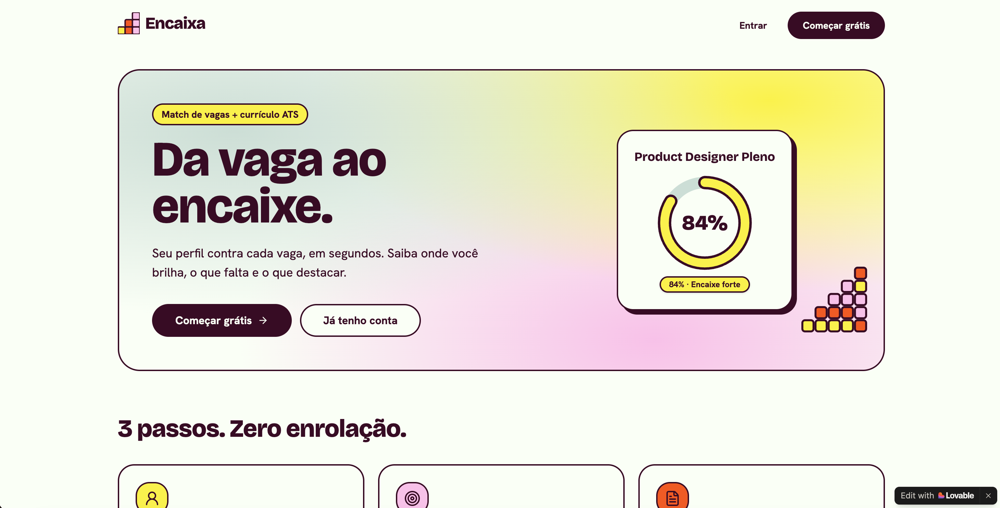
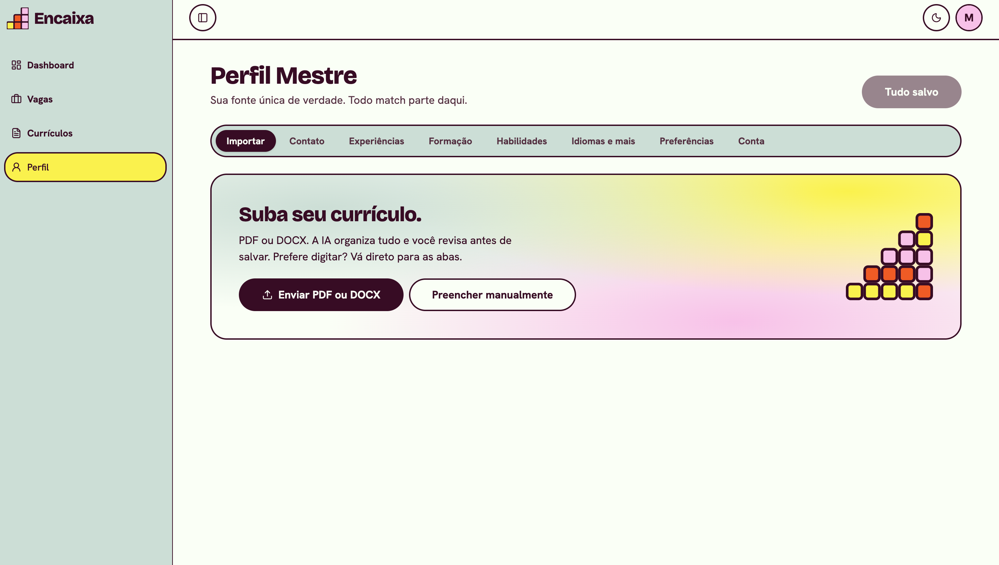
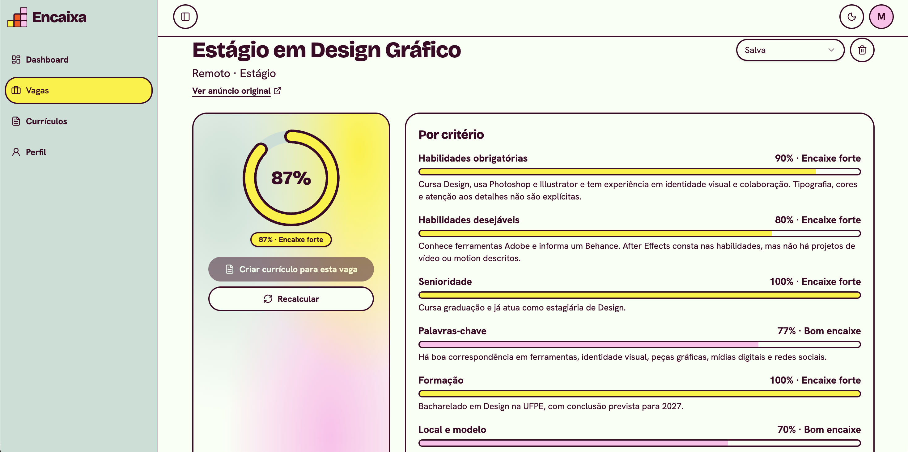
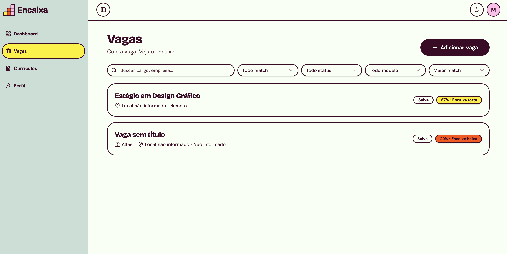

# Encaixa 🧩

> Da vaga ao encaixe.

O **Encaixa** compara o seu perfil com a descrição de uma vaga, mostra um score de match explicado (pontos fortes e lacunas) e gera uma versão do seu currículo em formato **ATS-friendly**, usando apenas informações reais do seu perfil.

🔗 **Aplicação publicada:** [PREENCHER: [(https://encaixe-match-perfil.lovable.app )](https://encaixe-match-perfil.lovable.app )

---

## 1. Qual problema o Encaixa resolve

Quem procura emprego costuma enviar o mesmo currículo para todas as vagas. Dois problemas aparecem:

1. **Filtros ATS (Applicant Tracking Systems).** Muitas empresas usam sistemas que leem o currículo de forma automática e descartam arquivos com layout complexo (colunas, tabelas, ícones, imagens) ou sem as palavras-chave da vaga.
2. **Falta de clareza sobre o encaixe.** É difícil saber, antes de se candidatar, o quanto o seu perfil realmente combina com a vaga e o que falta.

O Encaixa responde às duas perguntas: **"quanto eu combino com essa vaga?"** e **"como ajusto meu currículo para ela, sem mentir e sem quebrar o ATS?"**

## Prévia

| Landing | Perfil Mestre |
|---|---|
|  |  |

| Match com a vaga | Currículo ajustado |
|---|---|
|  |  |

---

## 2. O prompt e como ele evoluiu

O app foi gerado no **[(https://lovable.dev)](https://encaixe-match-perfil.lovable.app )** a partir de um "mega prompt" em Markdown.

### Versão 1: mega prompt único
Um único prompt descrevia tudo: stack (React, Vite, TypeScript, Tailwind, shadcn/ui, Supabase), identidade visual, e seis áreas funcionais (landing e auth, perfil mestre, vagas, match, gerador de currículo ATS, dashboard), além do modelo de dados e regras de qualidade.

### O que mudou até a versão final
O plano gratuito do Lovable limita os créditos por dia, e um prompt tão grande não cabia em 5 créditos. Por isso o prompt foi **dividido em dois**, cada um autossuficiente:

| Prompt | Escopo |
|---|---|
| **Parte 1: base** | Design system (tokens shadcn customizados), landing, auth, layout, Perfil Mestre, cadastro de vagas e match. O **banco inteiro** já foi criado aqui, inclusive as tabelas da Parte 2, para não gastar crédito migrando depois. |
| **Parte 2: currículo** | Gerador de currículo ATS, editor com preview, painel de ATS score, diff, histórico, exportação, Kanban de candidaturas e dashboard. |

Ajustes feitos no texto para economizar créditos:
- Instruções explícitas de **"executar tudo em uma única passada, sem pedir confirmações e sem funcionalidades extras"**;
- Botão "Criar currículo para esta vaga" já presente na Parte 1, **desabilitado** até a Parte 2;
- Paleta repetida de forma resumida na Parte 2, com a instrução de **não alterar o que já funcionava**;
- Correções visuais agrupadas em **uma única mensagem**, em vez de vários pedidos pequenos.


---

## 3. Como a análise funciona (da vaga colada ao currículo ajustado)

```
Perfil Mestre ──┐
                ├─► Match (score + lacunas) ─► Currículo ajustado ─► Exportação
Vaga colada ────┘
```

1. **Perfil Mestre.** A pessoa envia o currículo (PDF/DOCX) ou preenche manualmente. Uma função com IA extrai e estrutura contato, resumo, experiências, formação, habilidades, idiomas e certificações. Essa é a **fonte única de verdade**: todas as versões derivam dela.
2. **Vaga colada.** O texto da descrição é colado no app. A IA extrai título, empresa, local, modelo de trabalho, requisitos obrigatórios e desejáveis, responsabilidades e **palavras-chave ATS**.
3. **Match.** O perfil é comparado com a vaga. O resultado é um **score de 0 a 100**, com detalhamento por critério (habilidades obrigatórias e desejáveis, senioridade, palavras-chave, formação, local/modelo), **pontos fortes**, **lacunas** e sugestões do que destacar melhor.
4. **Currículo ajustado.** A IA reordena, prioriza e reescreve o conteúdo do Perfil Mestre usando os termos da vaga.
   - **Regra anti-invenção:** nada que não esteja no Perfil Mestre é inserido como fato. Lacunas aparecem como lacunas.
   - **Regras ATS do template:** coluna única, sem tabelas, ícones ou imagens; seções padrão (Resumo, Experiência Profissional, Formação, Habilidades, Idiomas, Certificações); fontes seguras (Arial/Calibri); datas em MM/AAAA; bullets no formato *verbo de ação + o que fez + resultado*; palavras-chave de forma natural, sem keyword stuffing.
5. **Exportação.** O currículo sai em PDF com texto selecionável (não imagem).

---

## 4. Identidade visual

Inspirada no brand design **PioneerAi**, do Unleash Studio: fundo claro esverdeado, blocos de cor chapada, tipografia pesada, bordas grossas em ameixa e motivo de blocos/pixels em degrau.

| Papel | Cor |
|---|---|
| Background | `#F8FFF3` |
| Primary / texto / borda | `#3A0622` |
| Muted | `#C7DED5` |
| Secondary | `#FFC5F1` |
| Accent | `#FFF100` |
| Destructive / foco | `#FF4200` |

Tipografia: **Bricolage Grotesque** (títulos) e **Hanken Grotesk** (corpo). O design system é baseado em **shadcn/ui**, com tema customizado.

> O currículo exportado usa fontes e layout neutros de propósito: a identidade colorida fica só no app, porque ATS lê melhor documentos simples.

---

## 5. Próximas versões

O limite de créditos por dia impediu terminar o segundo prompt de uma vez. Por isso o desenvolvimento seguirá em **versões pequenas**, com um objetivo por vez, para caber no limite diário. Itens marcados com `[x]` já foram entregues.

### v1.1: Exportar também em `.docx`
**Por quê:** o PDF é ótimo para enviar, mas a pessoa precisa editar o currículo antes de se candidatar (trocar um detalhe, ajustar um termo).
- [ ] Botão "Exportar .docx" ao lado do PDF
- [ ] Mesmas regras ATS do PDF (coluna única, sem tabelas e ícones, fontes Arial/Calibri)
- [ ] Texto 100% editável no Word e no Google Docs

### v1.2: Login com confirmação por e-mail
**Por quê:** hoje os dados não ficam protegidos por uma conta. Com login, cada pessoa tem seu Perfil Mestre, suas vagas e suas versões salvas.
- [ ] Cadastro e login com e-mail e senha
- [ ] E-mail de confirmação enviado pelo conector **Resend**
- [ ] Recuperação de senha
- [ ] Cada usuário vê apenas os próprios dados (RLS no Supabase)

### v1.3: Editor de currículo e ATS score
**Por quê:** hoje o currículo é gerado e exportado; falta poder revisar e entender o que mudou antes de enviar.
- [ ] Editor lado a lado, com preview do documento
- [ ] Painel de ATS score (palavras-chave encontradas × ausentes e checklist de boas práticas)
- [ ] Diff entre o Perfil Mestre e a versão gerada
- [ ] Histórico de versões por vaga, com duplicar e restaurar

### v2.0: Acompanhamento de candidaturas
**Por quê:** quem se candidata a várias vagas precisa saber onde cada uma está.
- [ ] Kanban (Salva, Candidatando, Enviada, Entrevista, Oferta, Encerrada)
- [ ] Notas e datas por candidatura
- [ ] Dashboard com resumo e funil de candidaturas
- [ ] Sugestões de próximos passos (ex.: vagas com match alto sem currículo gerado)

### Ideias para depois
- [ ] Importar a vaga por URL, além de colar o texto
- [ ] Versões do currículo em outros idiomas
- [ ] Modo escuro completo

---

## 6. Stack

React · Vite · TypeScript · Tailwind CSS · shadcn/ui · Supabase (Auth, Postgres, Storage, Edge Functions) · Lovable AI

## 7. Rodando localmente

```bash
git clone [PREENCHER: URL do repositório]
cd encaixa
npm install
cp .env.example .env   # preencha com as chaves do seu projeto Supabase
npm run dev
```

## 8. Créditos

Identidade visual inspirada no projeto *Brand design for PioneerAi*, do **Unleash Studio**. Este repositório é um projeto independente e não tem vínculo com a marca original.
